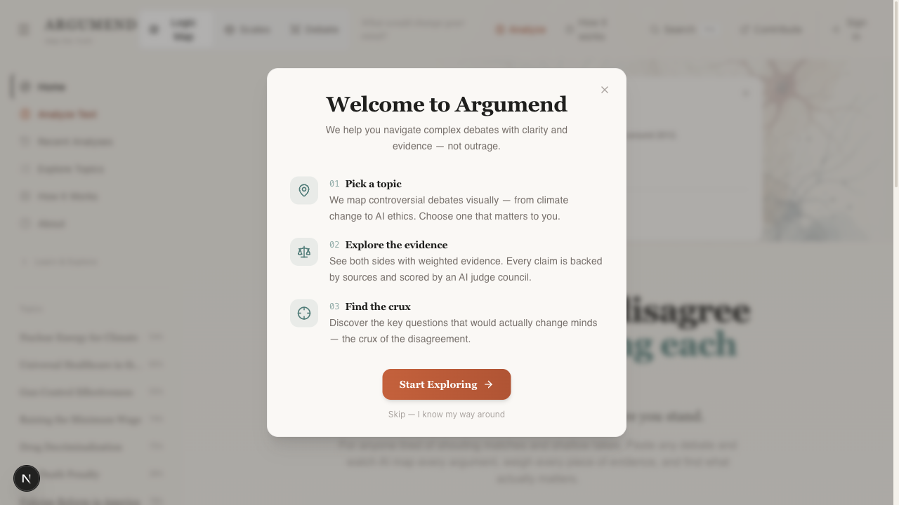
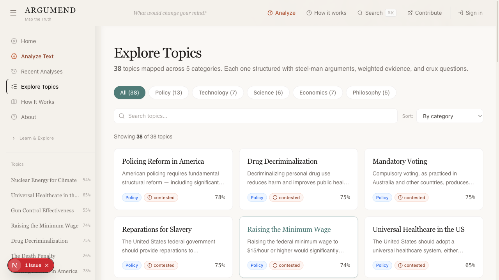
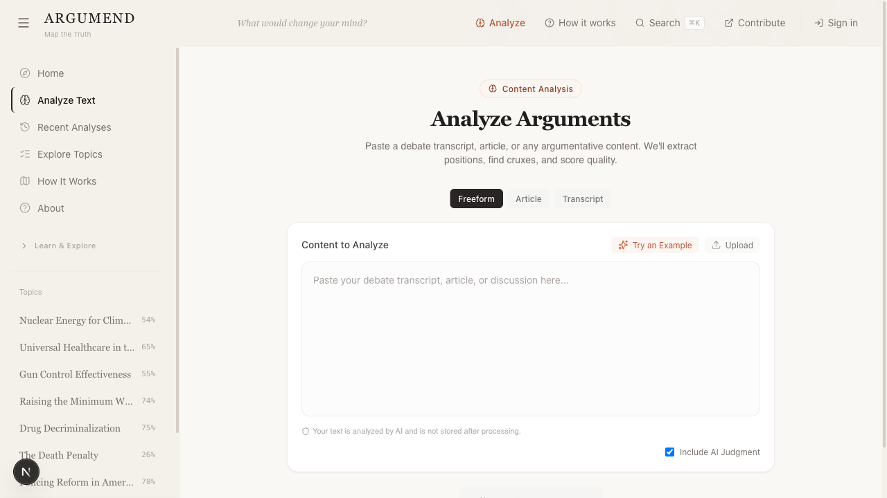

# Argumend

AI-powered argument mapping for contentious topics.

Argumend turns public questions into structured maps of positions, evidence, cruxes, confidence, and disagreement. The goal is not to make everyone agree. The goal is to make the disagreement legible enough that people can reason about it.

**Live site:** https://argumend.org

## Screenshots







## What It Does

- Presents contested questions as crux-first maps of positions, evidence, and what would change each side’s mind
- Offers interactive diagrams for legacy topic maps
- Shares alternate policy names across header, map-library, and question search, including rent caps, internet fast lanes, and job licensing
- Previews maps by their crux questions; clear multiword searches omit results that match only part of the query
- Matches pasted arguments to existing maps offline, without storing the paste
- Publishes essays and all public maps, including the flagship maps, in `/feed.xml`
- Optionally enables source-only AI disagreement diagnosis, debate generation, and judging
- Uses saved topic data so core flows can be developed without paid API calls
- Keeps the pruned CORE surface (`/`, `/topics`, `/analyze`, `/about`) crawlable with stable `?page=` URLs; hidden and merge-pending routes still serve directly but are excluded from the sitemap per `docs/PRODUCT_PRUNING_AUDIT.md`

## Tech Stack

- Next.js 16 App Router
- React 19 + TypeScript
- Bun for local development
- Tailwind CSS + Framer Motion
- React Flow for graph visualization
- Drizzle ORM + PostgreSQL
- NextAuth v5 beta
- Anthropic, OpenAI, and Google Generative AI SDKs
- Vitest + Testing Library

## Quick Start

Use Node.js 20.9 or newer and Bun 1.3.14. The repository, CI, and Docker
builder pin that Bun version so frozen-lockfile installs use the same toolchain.

```bash
bun install
bun dev
```

Open http://localhost:3000.

No API keys or database are required for the default offline mode.
The optional `.env.example` is safe to copy as-is: every external service is
blank and every live-mode flag is disabled.

## Runtime Modes

Argumend defaults to offline/programmatic generation and judging so the product can be developed and demoed without live model calls.

`/api/analyze` always matches pasted text against the existing map library offline;
it does not call a model or store the paste. In offline mode, `/api/judge`,
`/api/debate`, and `/api/debate/stream` also return programmatic results without
requiring auth, model API keys, or `DATABASE_URL`. If database persistence is
unavailable, debate and judging still return the computed result and skip saving.
The paste matcher withholds a map when the subject is unclear and offers
closest maps only when their overlap is strong enough to be useful. A matched
result links to the relevant crux on the reading page. Matching uses local
word overlap and a few calibrated subject checks, not semantic understanding;
unfamiliar subjects can still receive a closest-map list.
AI-education and AI-employment maps require AI or automation subject language;
ordinary online lessons and family disputes mentioning work do not qualify by themselves.
AI education also requires school, student, tutoring or other education language,
so an argument about AI diagnosis does not qualify through AI vocabulary alone.
Water scarcity, seed oils, vegan diets and AI diagnosis require their respective
subject cues; generic health benefits, inflammation or supplements do not qualify.
Voting dates and holidays do not qualify as a shorter working week, Electoral
College reform or social-media election influence without those subject cues.
Gig-worker classification also requires platform-work language, such as courier
apps or ride-hailing; generic shifts and voting schedules do not qualify.
Diamond ethics requires both a diamond subject cue and an ethical, environmental
or livelihood concern; conflict over water does not qualify through conflict alone.
Congestion-pricing matches also recognize downtown driving charges and city-center
entry fees; driver wording alone does not qualify unrelated fares or fees.
Health and college-policy maps also require their own subject language, so
surrogacy and school-start-time arguments do not qualify through shared words
about children or school. In an ambiguous result, rejecting an unrelated leader
can still leave a closest map if that finalist independently meets the overlap
floors and the paste uses a telling word of its name.
Phrase overlap qualifies a listed map only when the words occur together in
both texts, without joining across filler words or sentence boundaries.
Related maps also need a telling name cue or an explicit configured subject
cue in the paste, such as a rent freeze. Similarity between two whole maps
alone does not qualify a link on a particular result.
Maps ruled out by subject checks cannot compete as rivals or take over as siblings;
generic school vocabulary also does not qualify a homeschooling match.
Crux selection keeps filler words as phrase boundaries and checks for independent
subject cues before falling back to a map's lead question.
Matched results offer an optional preview before copying questions to explore together,
with the map link and conditions that could change each side's mind. A matched crux
also offers a short, previewable conversation starter to copy beside its map link.
When two cruxes are close, the action explicitly copies the first question.
The short takeaway retains the flagship map's stated scope.
On a map, choosing a reflection question also offers a preview and a copyable
conversation starter with a link directly to that crux and its evidence. The starter
includes the chosen question, not the reader's reflection answer or a verdict.
Related-map links require meaningful text overlap, or supporting overlap with a
shared subject tag. Without a shared subject tag, configured subject checks must
hold in both directions, so generic language about costs or adaptation cannot
connect water scarcity to birth rates. Broad categories do not fill empty slots:
a page may show fewer than three neighbours and always offers Browse all maps.
Drafts over 20,000 characters remain intact in the input, including incoming
handoffs. The reader must shorten them before submission; the app does not silently truncate them.
When no map matches, the offline guide helps readers write their own mind-change
conditions and common ground, with definitions and simple word cues in optional help.
The current draft, result and notes stay in tab memory across site navigation,
so returning from a map restores the working argument without another request.
Reloading, closing the tab or choosing "Paste another" clears them. New home-page
handoffs replace the working argument, and results are restored only under the same lane configuration.
Notes can be copied for a conversation. Reanalyzing unchanged text preserves them; submitting different
text or choosing "Paste another" clears them. Copying includes only the reader's notes, not the original
paste or an AI diagnosis. Notes are not sent or written to browser storage or history.

Database-backed sessions and debate persistence are enabled only when a
non-empty `DATABASE_URL` is explicitly configured. Without it, authentication
uses a degraded JWT mode and the browsing, analysis, and programmatic debate
flows remain available without attempting to initialize a database connection.
Persisted debates are private to the authenticated user who created them.
The judging API accepts evaluations via `POST`; it does not expose a global
recent-judgments collection, because verdict reasoning may derive from private
debate content.
After configuring the database, Google OAuth credentials, and `AUTH_SECRET`,
set `NEXT_PUBLIC_ENABLE_AUTH=true` to expose sign-in, the account dashboard,
and topic-follow controls. With the flag off, bookmarks remain device-local at
`/saved`; account-only navigation and follow controls are hidden, and direct
dashboard visits return to the local saved-topics view.
Removing a saved map announces the outcome and keeps keyboard focus on a remaining
map, or on Browse maps when the list becomes empty.

Enable live model-backed flows with environment flags:

```bash
ENABLE_LIVE_JUDGING_API=true
NEXT_PUBLIC_ENABLE_LIVE_JUDGING_API=true

ENABLE_LIVE_DEBATE_API=true
NEXT_PUBLIC_ENABLE_LIVE_DEBATE_API=true

ENABLE_DISAGREEMENT_V2=true
ARGUMEND_DISAGREEMENT_MODEL=claude-sonnet-4-20250514
```

Disagreement Diagnosis is a source-only lane of the one paste tool at `/analyze`
(`/analyze-v2` redirects there). It stays off unless `ENABLE_DISAGREEMENT_V2` is true
and a provider can run: the default Anthropic lane needs `ARGUMEND_DISAGREEMENT_MODEL`
and `ANTHROPIC_API_KEY` (see `lib/paste/lanes.ts`). It is a runtime server variable;
no build-time flag is involved. Without it, `/analyze` runs only the offline map match.
Publishing unlisted `/d/<slug>` reports also requires `ENABLE_DISAGREEMENT_PUBLISHING`,
`REPORT_PUBLICATION_SECRET`, and `DATABASE_URL`.

The legacy `ENABLE_LIVE_ANALYZE_API` and `NEXT_PUBLIC_ENABLE_LIVE_ANALYZE_API`
flags no longer enable extraction at `/api/analyze`; use the disagreement lane
above for model-backed diagnosis.

The unprefixed debate and judging `ENABLE_LIVE_*` flags are the server-side
authorization boundary for their provider calls. Their matching
`NEXT_PUBLIC_ENABLE_LIVE_*` flags only expose the corresponding mode in the browser UI and never authorize backend live work
on their own; enable both halves together for a live user-facing flow.
Because Next.js embeds `NEXT_PUBLIC_*` values in client assets, set those values
at build time. The unprefixed server flags and all credentials remain runtime
environment variables and must not be passed as Docker build arguments.

Configure at least one matching provider key from `.env.example` before
enabling a live flow. Google accepts `GOOGLE_AI_API_KEY` or `GEMINI_API_KEY`;
xAI accepts `XAI_API_KEY` or `GROK_API_KEY`.

Debate responses include a typed execution envelope that distinguishes the
requested mode/model from what actually generated each turn. If authentication
or a live provider is unavailable, the API returns a programmatic result marked
with a stable fallback code; provider error details are logged server-side and
are not exposed to clients.

Google Analytics is disabled by default, including in local development and
preview deployments. Enable it explicitly by setting a measurement ID:

```bash
NEXT_PUBLIC_GA_MEASUREMENT_ID=G-XXXXXXXXXX
```

Every map has a canonical crux-first reading page at `/topics/<topic-id>`. The
three flagship ArgumentGraph maps and legacy topic maps share that page
structure, with positions, crux questions, evidence, and resolution conditions.
The reading experience is server-rendered and works offline without API keys or
a database.

Legacy maps also offer an interactive diagram at `/topics/<topic-id>/map`.
Old `/?topic=<topic-id>&view=logic-map` and `/topics/<topic-id>?view=graph` links
redirect to that diagram; old root topic links without a diagram view redirect
to the reading page. Flagship maps use their reading page for old root links.
Crux links open their disclosure and move keyboard focus to its heading, so
readers can continue from the linked question.

Known public dynamic routes are validated in `proxy.ts` against lightweight
content indexes before App Router rendering begins. Invalid topic, blog, guide,
concept, fallacy, question, claim, worksheet, embed, and malformed analysis
URLs keep their public URL and query string but return a non-streamed,
crawl-safe 404 with a named page
landmark. This early boundary is intentional: a `notFound()` discovered after
React streaming starts can leave non-JavaScript clients without fallback
markup, and a segment `loading.tsx` can commit HTTP 200 before the missing-data
decision. Valid content and valid-format database-backed analysis IDs pass
through normally.

## Commands

```bash
bun dev              # local dev server
bun run build        # production build
bun run lint         # ESLint
bun run typecheck    # TypeScript without emitting files
bun run test         # Vitest, one complete run
bun run test:watch   # Vitest watch mode
bun run test:coverage
bun run test:e2e     # Chromium desktop/phone flows; run after a production build
bun run check:sources # validate and probe shipped evidence citations
bun run db:generate  # generate Drizzle migrations
bun run db:migrate   # apply committed, reviewed migrations
bun run db:push      # local prototyping only; do not use for deployments
bun run db:studio    # open Drizzle Studio
```

## Production Runtime

Production builds use Bun, while the deployed Next.js standalone server runs
on Node.js 20. The split is intentional: local, Docker, and Nixpacks builds use
the Bun lockfile, and Node provides the production RSC streaming runtime. The
repository's `.node-version`, `package.json` engine, Docker image, and Nixpacks
configuration all target Node 20.

Docker is the preferred Coolify deployment path because it runs as the
unprivileged `nextjs` user and includes a container healthcheck:

```bash
docker build -t argumend .
docker run --rm -p 3000:3000 argumend
```

For a client-visible feature, pass only its public build flag, for example
`docker build --build-arg NEXT_PUBLIC_ENABLE_AUTH=true -t argumend .`, then
provide `DATABASE_URL`, `AUTH_SECRET`, and provider credentials only to
`docker run` or the deployment runtime.

Add `--env-file .env` only when enabling optional persistence, authentication,
analytics, or live model providers.

Configure Coolify's health path as `/api/health`. The probe verifies that the
server is running and the static topic corpus is available; it deliberately
does not contact optional databases or model providers, so the default offline
product remains ready without credentials. The endpoint is dynamic and
non-cacheable.

`nixpacks.toml` remains supported when Dockerfile deployments are unavailable.
It performs `bun run build`, then uses `exec node` so termination signals reach
the standalone server. Coolify supplies `PORT`; both deployment paths bind to
`0.0.0.0`. Neither path runs database migrations automatically—apply reviewed
migrations as a separate, explicit release operation when persistence is
enabled.

### Trusted proxy hops

Every rate-limited API route keys its bucket on the client address, and that
address comes from `lib/clientIp.ts`, not from the raw header. A proxy
**appends** the peer it saw to `x-forwarded-for`; it does not replace what
arrived. The first entry is therefore whatever the caller wrote, and keying on
it lets anyone clear a limit by rotating a header value. The helper counts
`TRUSTED_PROXY_HOPS` entries back from the **end** instead, and falls back to
`x-real-ip`.

`TRUSTED_PROXY_HOPS` must equal the number of proxies that append a value
between the internet and the app:

| Deployment | Value |
|---|---|
| Coolify (Traefik only) | `1` — the code default |
| **argumend.org — Cloudflare in front of Coolify** | **`2` — verified 2026-09-22** |
| Any further proxy in the chain | add 1 for each |

**Production must run with `TRUSTED_PROXY_HOPS=2`.** This was verified on
2026-09-22: `curl -sI https://argumend.org/` answers `server: cloudflare` with
a `cf-ray` and `cf-cache-status`, so Cloudflare terminates the connection and
Traefik sees Cloudflare's edge as its peer. Two proxies append, so the
visitor's address is second from the end. The built-in default of `1` is the
safe value for a bare Coolify deployment and is **wrong for this one** — at `1`
every limit keys on a Cloudflare edge address shared by many visitors, so
unrelated people exhaust each other's buckets. A production process that
leaves the variable unset logs one warning to that effect on the first request
it handles (`lib/clientIp.ts`); it warns rather than refuses to boot, because
a wrong hop count degrades rate limiting without breaking serving.

Re-verify after any CDN change. Setting it too high makes unrelated clients
share a bucket; too low and the limit is bypassable. Verify against a real
request rather than guessing —
temporarily log the header from a deployed route, or add a scratch endpoint:

```ts
// app/api/whoami/route.ts — remove before merging.
export function GET(request: Request) {
  return Response.json({
    forwarded: request.headers.get("x-forwarded-for"),
    realIp: request.headers.get("x-real-ip"),
  });
}
```

Hit it from outside the network (`curl https://argumend.org/api/whoami`) and
count the entries:

- `"203.0.113.9"` — one entry, appended by Traefik. Your real address, so
  `TRUSTED_PROXY_HOPS=1`.
- `"203.0.113.9, 172.18.0.4"` — Cloudflare appended your address, Traefik
  appended Cloudflare's. Your address is second from the end:
  `TRUSTED_PROXY_HOPS=2`.

Then repeat the request with a spoofed prefix —
`curl -H 'x-forwarded-for: 1.2.3.4' https://argumend.org/api/whoami` — and
confirm the value at your configured hop count is still your own address and
not `1.2.3.4`. If a spoofed entry lands on that position, the number is wrong.

**`cf-connecting-ip` is deliberately not read**, even though Cloudflare sets
it. Traefik does not strip it, and the origin is not locked to Cloudflare's IP
ranges, so anyone who finds the origin address can reach it directly with any
`cf-connecting-ip` they like — reintroducing the exact bypass this design
exists to close. Trusting it would first require proving the request came
through Cloudflare (authenticated origin pull, or matching the last
`x-forwarded-for` entry against Cloudflare's published ranges, a list that
moves and would silently rot). It would then be redundant anyway: Cloudflare
appends the same address to `x-forwarded-for`, which is precisely what
`TRUSTED_PROXY_HOPS=2` reads. If the origin is ever locked to Cloudflare's
ranges at the firewall, this is worth revisiting.

The regression suite for this lives in `app/api/rate-limit-client-ip.test.ts`,
which replays the bypass against every rate-limited route, and in
`lib/clientIp.test.ts`, which covers the hop arithmetic and the warning.

After any production build, verify the assembled standalone directory locally:

```bash
bun run smoke:standalone
```

That smoke check starts the packaged server with every optional integration
disabled; verifies health, the homepage, public and Next static assets, API v1,
offline analysis, programmatic debate, and offline judging without persistence;
then sends `SIGTERM` and requires the process to stop promptly. The smoke and
Playwright launchers share optional-service overrides in
`scripts/offline-server-env.mjs`, so inherited runtime flags cannot enable
diagnosis, Jev, publishing, or metric logging during these checks. Build with
public live/auth/Jev flags disabled and analytics unset before running offline
checks: runtime overrides cannot change `NEXT_PUBLIC_*` values already embedded
in client assets.

## Database Migrations

Production and shared environments should be updated with committed migrations,
not `db:push`:

1. Change `lib/db/schema.ts`.
2. Run `bun run db:generate -- --name <descriptive-name>` locally.
3. Review the generated SQL and snapshot under `drizzle/`.
4. Back up the target database, configure its `DATABASE_URL`, and run
   `bun run db:migrate` once during deployment.

Migration `0001_privacy_auth_schema` creates the Auth.js, newsletter, saved-topic,
topic-view, and topic-subscription tables; adds analysis/debate ownership and
current indexes; and adds the newer derived analysis fields. It also intentionally
drops the historical `analyses.content_hash` and `analyses.input_content` columns
as a privacy cleanup. That data removal is irreversible, so back up any existing
database before applying the migration.

## Project Structure

```text
app/                    Next.js routes, pages, API endpoints
components/             Product UI, graph views, topic cards, shell
components/nodes/       React Flow node components
data/                   Static topics, guides, blog content, mock debates
hooks/                  Client state and graph orchestration
lib/paste/              Offline paste-to-map matching and lane selection
lib/disagreement/       Optional source-only disagreement diagnosis
lib/analyze/            Legacy argument extraction utilities
lib/debate/             Debate generation and persistence
lib/judge/              Multi-model judging
lib/db/                 Drizzle schema and database helpers
types/                  Shared TypeScript types
```

## Development Notes

- Use offline mode unless a task specifically needs live model behavior.
- Keep topic data deterministic so graph behavior is easy to test.
- Prefer typed schemas at boundaries; do not let raw model output flow directly into UI state.
- Run `bun run test` and `bun run lint` before opening a PR. (`bun test`
  invokes Bun's separate native runner and does not load this project's Vitest
  configuration.)

## License

[ISC](LICENSE)
